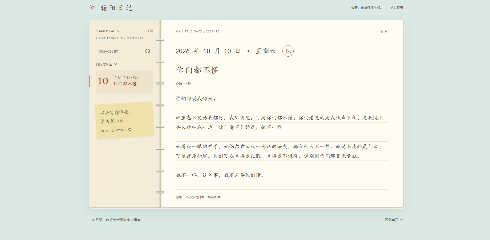
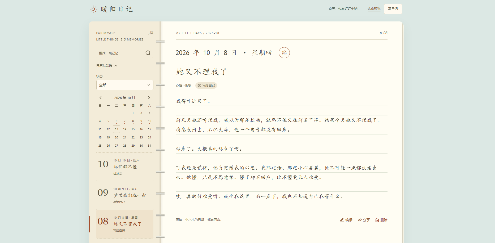

# 暖阳日记 · warm-diary

## 声明

文档与截图中的展示数据均为虚构，如有雷同，纯属巧合。

## 简介

面向 Halo 站长的个人文字日记本，需要 **Halo 2.26.0 或更新版本**。前台是纸本手帐，后台直接使用 Halo Console 组件。新日记默认写给自己，也可以单独分享某一篇。

## 安装与使用

在 Console 的「插件」中上传 `build/libs/plugin-warm-diary-1.0.0.jar` 并启用。

1. 写日记、读未分享的内容需要「暖阳日记管理」角色，超级管理员默认拥有；需要别人一起写时，在「用户管理」里给账号分配这个角色。
2. 在后台或 `/diary` 写日记。日期可以补写，一天可以写多篇；标题、心情、天气都可以留空。
3. 内容自动保存。后台「⋯ → 分享」或前台「分享」，预览确认后访客才能读到；之后的修改要再「更新分享」。
4. 时区与手帐便笺在插件设置里填写，留空则用服务器时区和默认便笺。

| 入口 | 用途 |
| --- | --- |
| `/console/warm-diary` | 管理日记 |
| `/console/warm-diary/deleted` | 回收站 |
| `/diary` | 目录：有管理权限的看全部，其他人只看已分享的 |
| `/diary/write` | 写日记 |
| `/diary/entry/{name}` | 阅读：有管理权限的看当前内容，其他人看已分享的版本 |

一篇日记要么「写给自己」，要么「已分享」。操作是「分享 / 更新分享 / 收回分享」；「删除」进回收站，可「恢复」或「永久删除」。

前台走主题模板渲染，全站变灰一类注入 `<head>` 的插件可以生效。可在 Halo 菜单中自行添加入口，以上路径需留给插件使用。

### 前台手帐

访客只看到已分享的日记：



有管理权限的账号看全部日记，可以写、编辑、分享和删除，也可以「访客预览」：



左侧目录、右侧正文。目录顶上左边是视角（有管理权限的账号 `FOR MYSELF`，访客 `SHARED PAGES`），右边是篇数；按月筛选时月份标题在最左。点一篇只换右侧正文。日历对所有人开放，访客只看到已分享的日期；筛选和页码写在地址里。

### 后台

列表沿用 Halo 文章列表：回车搜索，按状态、日期、心情、天气筛选，条件和页码写入地址。行尾眼睛图标表示是否已分享。有未分享修改时，标题旁有状态点，「阅读」可对照当前内容和访客看到的版本。勾选后可批量操作；分享仍逐篇预览确认。

## 保存与隐私

- 普通登录用户和匿名访客一样，只能读已分享的版本；未分享的内容只有拥有「暖阳日记管理」角色的账号能读，这些账号之间彼此不隔离。
- 分享复制出独立版本，之后的自动保存不改变它，直到再次「更新分享」。
- 未分享的内容不出现在访客的目录、搜索、日历和单篇里，也不进入站点搜索、RSS、站点地图。
- 不提供单独导出，日记随 Halo「备份与恢复」一起备份。

这是站点访问权限隔离，不是端到端加密。能直接访问数据库或服务器的人仍可看到底层数据。

## 接口

OpenAPI 分组为 `warmDiary`。

| 分组 | 说明 |
| --- | --- |
| `api.warm-diary.timxs.com/v1alpha1` | 所有身份共用的阅读接口，按登录身份返回可读内容 |
| `console.api.warm-diary.timxs.com/v1alpha1` | 需要「暖阳日记管理」角色；写入带 `X-Warm-Diary: 1`，并校验版本号 |

无权、不存在或已进回收站的日记一律返回 HTTP 404。

## 开发环境

- Java 21+
- Node.js >=22.12.0
- pnpm

## 开发

```bash
# 启用插件
./gradlew haloServer

# 开发前端
cd ui
pnpm install
pnpm dev
```

手帐前台由 `pnpm run build:notebook` 构建，并随插件打包。

接口契约改变时，重新生成客户端（输出到 `ui/src/api/generated/`，不要手改）。生成前先把 `haloPlugin { openApi { ... } }` 配置从 git 历史恢复到 `build.gradle`（对齐官方脚手架时移除了它），再运行：

```bash
./gradlew generateApiClient -PhaloApiUrl=http://127.0.0.1:8098
```

对接的 Halo 需开启 OpenAPI：

```yaml
springdoc:
  api-docs:
    enabled: true
    version: OPENAPI_3_0
  group-configs:
    - group: warmDiary
      display-name: Warm Diary
      paths-to-match:
        - /apis/console.api.warm-diary.timxs.com/v1alpha1/**
        - /apis/api.warm-diary.timxs.com/v1alpha1/**
```

## 构建

```bash
./gradlew build
```

构建完成后，可以在 `build/libs` 目录找到插件 jar 文件。构建同时运行 Java 测试、Vue 类型检查和前端单元测试。

## 许可证

[GPL-3.0](./LICENSE) © Tim0x0
